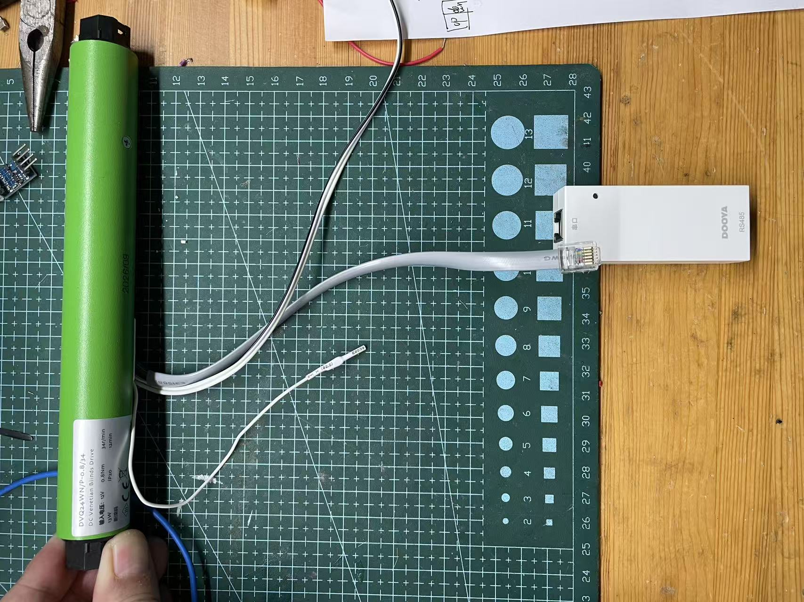
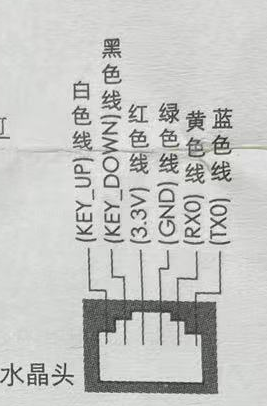

# Dooya 55 AA TTL Protocol

Reverse engineering of the private `55 AA` TTL protocol used by Dooya tubular
motors, so the official adapter can be dropped and the motor driven from a plain
ESP8266 / ESP32.

**English** · [简体中文](README.zh-CN.md)


## 1. Project Background

Dooya (杜亚) motor kits ship with a small protocol translator in the box, e.g.
`DC1545W`. These translator modules come in many variants — different platforms,
different voice assistants, different radios — but the motor itself is a single
SKU that always speaks the same language. The RS485 adapter here is just the
example this repo was built from: on its outside it speaks RS485 with the
standard Dooya `55 FE FE` protocol, and on the inside it silently repackages
everything into a private `55 AA` TTL frame before handing it to the motor.

The practical consequence: wire a microcontroller straight to the motor's 6-pin
cable, send standard `55 FE FE` frames, and the motor **ignores you completely**.
No error, no reply.

This repository documents that private protocol end to end — frame layout,
the CRC-16 that is easy to get wrong, control commands, position polling and
unsolicited status reports — enough to talk to the motor directly and put the
blind on Home Assistant / ESPHome / anything else.

All numbers below were obtained by tapping a logic analyser onto the link
between the official adapter and the motor; nothing here is guessed from a
datasheet. The example sketch prints the same frames as they go by, which is
enough to check a unit before trusting the tables below.

## 2. Compatibility

Tested on motors using the 6-pin RJ11-style crystal-head cable, including:

* Roller blinds
* Honeycomb / pleated blinds
* Venetian blinds *(the angle byte is meaningful here)*
* Zebra / day-night blinds

Reference models: `DVQ24WN`, `DVQ24AF`, and other Dooya-built OEM motors.
If your motor came with a `DC1545W` style adapter, it is very likely this
protocol — verify with a logic analyser or a serial sniffer before trusting it.

## 3. Hardware: Bypassing the Adapter

### 3.1 Wiring

Hang a small ESP8266 right on the motor's RJ11 plug — the motor's own 3.3 V
rail drives it directly, no separate supply needed. **Cross TX and RX.**


*The motor (here a `DVQ24WN`), its 6-pin cable and the official RS485 adapter.*

| Motor signal | MCU pin (example) | Notes |
| :--- | :--- | :--- |
| motor RX | **TX** (D7 / GPIO13) | MCU transmits, motor receives |
| motor TX | **RX** (D6 / GPIO12) | motor transmits, MCU receives |
| GND | **GND** | common ground is mandatory |
| 3.3 V out | — | directly powers the small ESP8266 at the connector |
| KEY UP | leave open | short to GND to trigger up |
| KEY DOWN | leave open | short to GND to trigger down |

Pinout of the plug (wire colours are labelled in the image):


*From left: `KEY_DOWN`, `KEY_UP`, `3.3 V` out, `GND`, `RXO` (motor RX), `TXO` (motor TX).*

The two KEY wires are the fallback: if your unit turns out to speak a different
dialect, shorting them to GND still moves the blind, which makes them a usable
plan B for a controller that does not need position feedback.

### 3.2 Serial parameters

**9600 baud, 8N1.** Wait at least 3.5 character times (≈ 3.65 ms, 6 ms to be
safe) between frames, and judge the end of a received frame the same way.

> Note on ESP8266: `D6` is `GPIO12` (MTDI), a boot strap pin — if the motor's
> TX line holds it high at power-up, some modules refuse to boot (the chip then
> expects 1.8 V flash). Power the motor after the MCU, or move the wire to
> another pin if that happens.

## 4. Frame Format

| Byte | Field | Meaning |
| :--- | :--- | :--- |
| 0 | start | fixed `0x55` |
| 1 | start | fixed `0xAA` |
| 2 | length | number of bytes from the function code to the **CRC low byte** (= total length − 3) |
| 3 | function | `0x01` control, `0x02` query / query reply, `0x03` unsolicited status report |
| 4 … N-2 | data | depends on the function code |
| N-1, N | CRC16 | **high byte first, low byte second** |

The smallest frame is 7 bytes (`0x55 0xAA 0x04 0x02 0x02 …`), the largest seen
is 15 bytes (status report). Example — "open", 8 bytes total, length field
`0x05`:

```
55 AA 05 01 01 01 EA A9
 |  |  |  |  |  |--+-- CRC16 = 0xEAA9
 |  |  |  |  |-+----- channel / address (01 01)
 |  |  |  |--+------- action code (01 = open)
 |  |  |--+--------- function code (01 = control)
 |  |--+----------- length
 +--+------------- start bytes
```

## 5. CRC-16

This is the part almost every implementation gets wrong, so it gets its own
section.

### 5.1 Parameters

| Parameter | Value |
| :--- | :--- |
| width | 16 |
| polynomial | `0x8005` |
| initial value | `0xFFFF` |
| input reflection (refin) | **no** — bytes are fed MSB first |
| output reflection (refout) | **no** |
| final XOR (xorout) | `0x0000` |
| covered range | `0x55` … last data byte (start bytes included, CRC bytes excluded) |
| byte order in frame | **high byte first**, low byte second |
| check value (`"123456789"`) | `0xAEE7` |

The `0xAEE7` check value identifies this as the parameter set commonly called
**CRC-16/CMS**.

### 5.2 It is not Modbus CRC

Same polynomial as CRC-16/MODBUS (`0x8005`), which is exactly why people plug in
a Modbus CRC routine and then wonder why the motor stays silent. Three
differences:

| | Dooya 55AA | CRC-16/MODBUS |
| :--- | :--- | :--- |
| input reflection | no (MSB first) | yes |
| register reflection | no | yes |
| CRC byte order in frame | high byte first | low byte first |

Getting any one of the three wrong yields a well-formed frame with a valid
length field and a CRC the motor drops without a word.

### 5.3 Reference implementation

Dependency-free implementations live in [`crc/`](crc):

* [`crc/dooya_crc.h`](crc/dooya_crc.h) / [`crc/dooya_crc.c`](crc/dooya_crc.c) —
  C: `dooya_crc16()` computes the CRC, `dooya_frame_finish()` appends it to a
  frame body in place
* [`crc/dooya_crc.py`](crc/dooya_crc.py) — Python, with a self test:
  `python3 dooya_crc.py`

At 9600 baud the bit-at-a-time version is plenty fast (a 16-byte frame is 128
iterations). If you prefer a table-driven version, generate it with
`refin = refout = false`.

### 5.4 Test vectors

Frames marked *captured* came off the wire between the official adapter and the
motor; the rest are computed with the reference implementation and are listed so
you can cross-check a port.

| Meaning | Complete frame (hex) | Source |
| :--- | :--- | :--- |
| query position | `55 AA 04 02 02 38 74` | captured |
| open | `55 AA 05 01 01 01 EA A9` | captured |
| close | `55 AA 05 01 01 02 EA A3` | captured |
| stop | `55 AA 05 01 01 03 6A A6` | captured |
| set position 50 % | `55 AA 06 01 02 32 67 00 9A` | captured |
| set position 0 % | `55 AA 06 01 02 00 67 2C 99` | computed |
| set position 1 % | `55 AA 06 01 02 01 67 AA 9A` | computed |
| set position 100 % | `55 AA 06 01 02 64 67 74 9F` | computed |
| reply: current position 50 % | `55 AA 05 02 02 32 E0 3F` | captured |
| report: closing, 0 % | `55 AA 0C 03 01 02 00 0B 01 00 02 00 00 DB 3B` | captured |
| report: stopping, 50 % | `55 AA 0C 03 01 03 32 B4 01 00 02 00 00 D2 A9` | captured |
| report: trimming, 50 % | `55 AA 0C 03 01 01 32 A9 01 00 02 00 00 2A BB` | captured |
| report: settled, 50 % | `55 AA 0C 03 01 03 32 64 01 00 02 00 00 52 77` | captured |

### 5.5 Validating a received frame

1. `buf[0] == 0x55 && buf[1] == 0xAA` — otherwise drop and resync.
2. `frameLen = buf[2] + 3` — a frame may arrive in pieces, so wait until
   `frameLen` bytes are in hand (or the line went quiet for > 6 ms and you have
   less: then it is truncated, drop it).
3. `recvCrc = (buf[frameLen-2] << 8) | buf[frameLen-1]` — again: **high byte
   first**.
4. `recvCrc == dooya_crc16(buf, frameLen - 2)`.

Logging `recvCrc` and the computed value side by side is the fastest way to spot
a port that got the reflection or the byte order wrong — you will see a
consistent mismatch rather than random noise.

## 6. Commands (Host → Motor)

| Action | Frame |
| :--- | :--- |
| open (up) | `55 AA 05 01 01 01 EA A9` |
| close (down) | `55 AA 05 01 01 02 EA A3` |
| stop | `55 AA 05 01 01 03 6A A6` |
| set position | `55 AA 06 01 02 <percent> 67 <crc_h> <crc_l>` |
| query position | `55 AA 04 02 02 38 74` |

* `<percent>` is `0x00` … `0x64` (0–100 %), hex.
* `0x67` was observed constant on roller blinds; it is presumably the angle
  parameter for venetian blinds. Keep it at `0x67` unless you know better.
* `01 01` is channel / device address. It stayed `01 01` in every capture.
* The motor acknowledges nothing for control frames; the only feedback is the
  status report that follows, or a position query.

## 7. Replies and Reports (Motor → Host)

**Query reply** — `55 AA 05 02 02 <position> <crc_h> <crc_l>`

No state byte at all, so if you need to know "is it moving", poll repeatedly and
compare positions.

**Unsolicited status report** — `55 AA 0C 03 01 <state> <position> <angle> 01 00 02 00 00 <crc_h> <crc_l>`

| State | Meaning |
| :--- | :--- |
| `0x01` | opening (up) |
| `0x02` | closing (down) |
| `0x03` | stopped / limit reached / idle |

The status byte is authoritative — use it instead of guessing from position
changes when you have it. During the last few percent the motor may hop between
`0x03` and `0x01` while it trims itself into place; that is normal.

The angle byte is meaningful for venetian blinds and noise for roller blinds.
The five trailing data bytes (`01 00 02 00 00`) were constant in every capture
and are ignored here.

The motor reports on its own while it moves and shortly after it stops, but it
does **not** report periodically while idle — that is why a controller still
needs to poll.

## 8. Software Architecture

### 8.1 Receiving

* `SoftwareSerial` at 9600 8N1 (or a hardware UART if you have one free).
* Frames are delimited by line silence: 6 ms (3.5 character times at 9600 baud)
  after the last byte, whatever is buffered is treated as one frame.
* Before parsing, scan for the `0x55 0xAA` pair so leading noise does not
  invalidate the frame.
* Then check the length field and the CRC. A damaged frame is dropped, never
  half-parsed.
* A 64–256 byte buffer is enough; the largest frame is 15 bytes.

### 8.2 Decoding flow

1. Validate the whole frame (start pair, length, CRC-16).
2. Switch on the function code:
   * `0x02`, 8 bytes → query reply, payload position is `buf[5]`;
   * `0x03`, 15 bytes → status report, `buf[5]` state, `buf[6]` position,
     `buf[7]` angle;
   * `0x01` is what the host sends; a motor does not normally echo it.
3. Convert position to percent (`0x00`–`0x64` is already 0–100) and expose it.
4. Publish the state: the report's state byte when available, otherwise the
   direction inferred from consecutive positions.

### 8.3 Position, state and polling

| Question | Answer |
| :--- | :--- |
| How do I get the position? | Send `55 AA 04 02 02 ...` and read `buf[5]` from the reply. Poll every 1 s; faster buys nothing, the motor answers at its own pace. |
| How do I know it is moving? | Use the state byte from a status report if one arrives; otherwise watch the position trend and call it stopped after the value has been unchanged for a couple of seconds. |
| Does it report while idle? | No. Polling is required. |
| What about the last few percent? | The motor trims into place and may oscillate between `0x03` and `0x01`. Debounce state changes for ~1 s, or compare the reported position to the target. |

A controller therefore only needs three things: a periodic position query, a
receive path that decodes reports, and a send path that builds one command at a
time with a 6 ms gap.

## 9. Example Code

One self-contained Arduino sketch (ESP8266) lives in
[`examples/dooya_55aa_controller/`](examples/dooya_55aa_controller/). It is a
plain Arduino project (`.ino` in the folder root) that opens directly in the
Arduino IDE and also builds with PlatformIO.

Everything is in that single sketch:

| Feature | How |
| :--- | :--- |
| Commands | serial console: `o` open, `c` close, `s` stop, `p50` set position, `q` query |
| Position polling | one query per second while idle, so the percentage is always known |
| Replies and reports | validated (start pair, length, CRC), decoded into position and state |
| State | the report's status byte when available, position trend otherwise |
| Hex dump | every frame on the wire, toggled at runtime with `d` |

The pin convention is the one from section 3 (`D6` = motor TX, `D7` = motor RX,
9600 8N1), and the wiring table applies unchanged. The example's own README has
the command reference, a sample session and the configuration macros.

## 10. Repository Layout

```
README.md          this file (English)
README.zh-CN.md    Chinese version
crc/               reference CRC-16 implementation (C and Python) + self test
examples/
   dooya_55aa_controller/   one ESP8266 sketch with all the features above
```

## 11. License and Disclaimer

MIT.

Reverse engineered for interoperability with hardware I own. Not affiliated with,
endorsed by, or supported by Dooya. Motors and adapters differ between batches;
if the motor ignores you, capture the real traffic — that is how every number in
this document was obtained, and it beats guessing.
